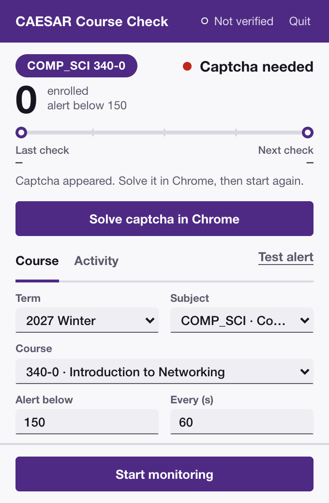
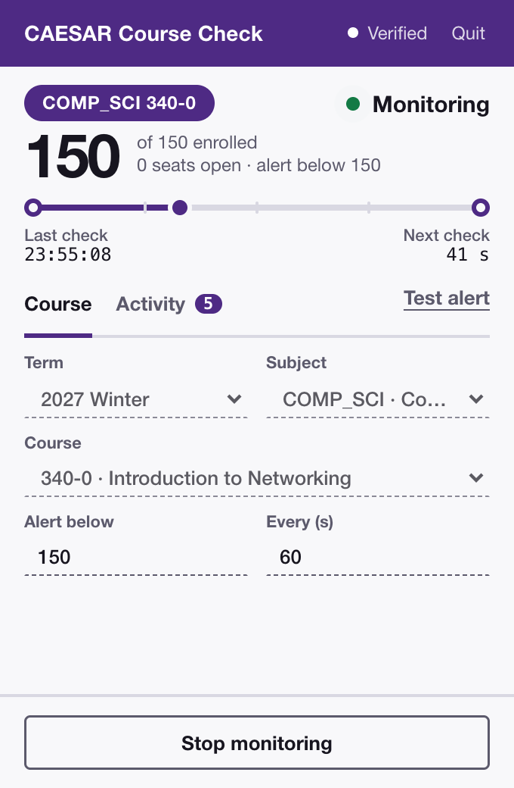
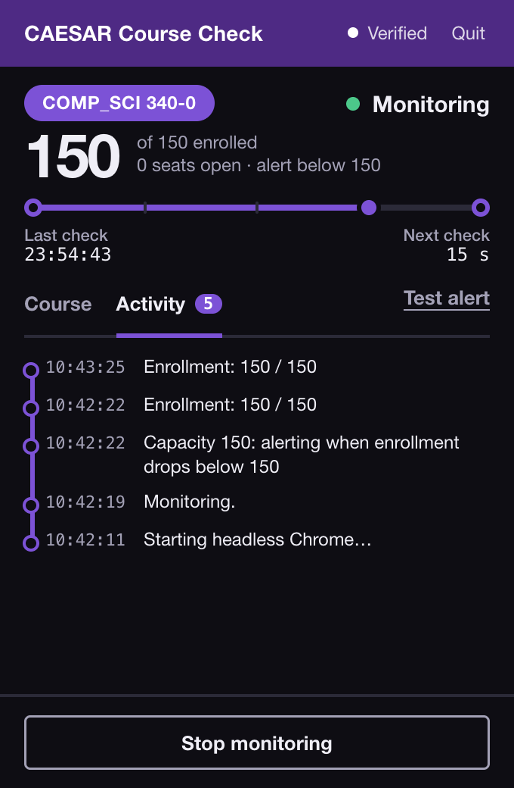
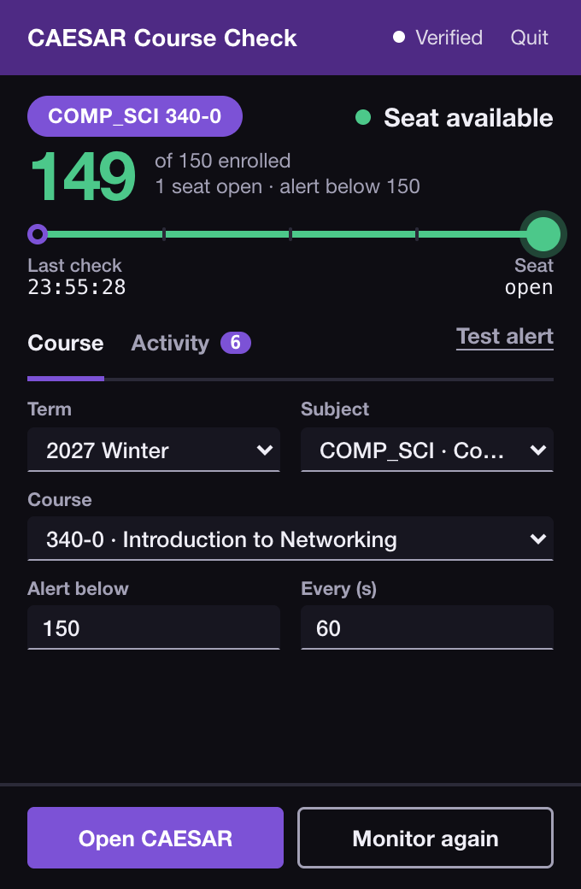

<p align="center"></p>

# CAESAR Course Check

A small tray app that watches a Northwestern CAESAR class and alerts you the moment a seat opens.
It lives in the **macOS menu bar** or the **Windows system tray**: click the icon, the whole app opens as a popover.

| First run (light) | Monitoring (light) | Activity (dark) | Seat found (dark) |
|---|---|---|---|
|  |  |  |  |

> Screenshots use sample data and a browser render of the popover; the menu bar / tray strip itself isn't pictured.

## Design
Theme: **Purple Line wayfinding**, after the CTA Purple Line out of Evanston. A saturated Northwestern-purple header band, a course roundel, state as station bullets, and a route strip whose "train" is the time since the last check. Light mode is the daytime platform, dark mode the night platform. The Activity log is a line of stops.

## Features
- Checks enrollment about once a minute (a random ±15 s jitter is added) in a **headless** Chrome.
- Alerts with a sound, a macOS notification and by opening the popover when a seat opens, meaning enrollment drops below the class capacity.
- **Dropdowns for term, subject and course**, built from the scraped course catalog (each has an "Other…" option if you want to type your own).
- **Shows open seats:** the first check reads the class capacity, sets "Alert below" to it, and the header shows enrolled / capacity and seats open.
- **Graduate courses just work:** catalog numbers 400 and up switch CAESAR's School to The Graduate School automatically.
- **Lives in the menu bar / tray:** no main window and no Dock icon. macOS shows a cap icon plus the live enrollment number while monitoring; Windows shows a tray icon with a flyout that hides when you click away. Monitoring keeps running while the popover is closed.
- Light and dark mode.

> **Windows status: untested.** The tray icon and flyout (`tray_win.py`) have never run on a real Windows machine, and no `.exe` has been built. Known risks: with display scaling the flyout may land in the wrong spot, and if reading the native window handle fails the flyout won't hide when you click away.

## Requirements
- **Google Chrome** installed.
- macOS (the CI build is Apple Silicon only; build locally for Intel) or Windows 10/11.

## Install
Build it yourself (see **Build** below) until a release is published. Then:
- macOS: open `CAESAR-Course-Check.dmg`, drag the app to **Applications**.
- Windows: run `CAESAR Course Check.exe`.

The builds are **unsigned**, so the first launch needs one extra step:
- macOS: right-click the app → **Open** (or `xattr -dr com.apple.quarantine "/Applications/CAESAR Course Check.app"`).
- Windows: SmartScreen → **More info → Run anyway**.

## How to use
1. Launch the app, then click its icon in the menu bar / tray (it does not open by itself). Pick the term, subject and course.
2. Click **Start monitoring**. It checks headless in the background.
3. CAESAR shows a reCAPTCHA, so the first run stops with **Captcha needed**. Click **Solve captcha in Chrome**, solve it by hand in the visible window, and it closes by itself. The session is saved, so you only repeat this when the captcha comes back.
4. Click **Start monitoring** again. When enrollment drops below the threshold you get an alert and monitoring stops.

No CAESAR login is involved, only the captcha. The app never solves captchas for you, and headless browsing tends to trigger them more often than a normal window.

## Develop
```bash
uv sync
(cd frontend && npm install && npm run build)
uv run python run_app.py
```

Stack: Python + FastAPI (API), async Playwright (browser automation), Svelte + Vite (UI), pyobjc NSStatusItem/NSPopover (macOS), pystray + pywebview (Windows), PyInstaller (packaging).

```
caesar_checker/   backend: checker.py (Playwright), server.py (FastAPI), app.py (window), tray.py (macOS menu bar popover), tray_win.py (Windows tray flyout)
frontend/         Svelte UI, built into caesar_checker/static
packaging/        PyInstaller build, icon + DMG artwork (.app + .dmg on macOS, .exe on Windows)
scraper/          scrapes class-descriptions.northwestern.edu into data/; build_catalog.py writes caesar_checker/catalog.json (the dropdown data)
data/             scraped course catalog (JSON per school/subject)
scripts/          course_pw.py, the original standalone terminal checker
assets/ docs/     app icon / DMG art, README screenshots
run_app.py        app entry point (also the PyInstaller entry)
```

## Build
Icon and DMG artwork are generated by `packaging/make_icon.py` into `assets/` (the build runs it for you). The macOS build is a menu-bar-only `.app` (no Dock icon), ad-hoc signed, packed into a DMG with a drag-to-Applications layout.

```bash
uv run python packaging/build.py
```
- macOS → `dist/CAESAR-Course-Check.dmg`
- Windows → `dist/CAESAR Course Check.exe` (or run `packaging\build_windows.bat`)

PyInstaller can't cross-compile, so build the Windows `.exe` on Windows or with the included GitHub Actions workflow (`.github/workflows/build.yml`).

## Course catalog
The dropdowns read `caesar_checker/catalog.json`, which is built from the scraper's output in `data/`. To refresh it for a new term:

```bash
uv run python scraper/main.py            # scrape class-descriptions.northwestern.edu into data/ (slow)
uv run python scraper/build_catalog.py   # rebuild caesar_checker/catalog.json, then rebuild the app
```

> The School dropdown and the class-capacity field use PeopleSoft element IDs that haven't been confirmed against the live CAESAR page. If either isn't found, the Activity log says so and the app falls back to the default School and your typed "Alert below" number.

## Where data is stored
Session, saved settings and logs live in the per-user data folder `CaesarCourseCheck`
(`~/Library/Application Support/` on macOS, `%LOCALAPPDATA%` on Windows). Delete it to forget the saved captcha session.

## License
[MIT](LICENSE)
