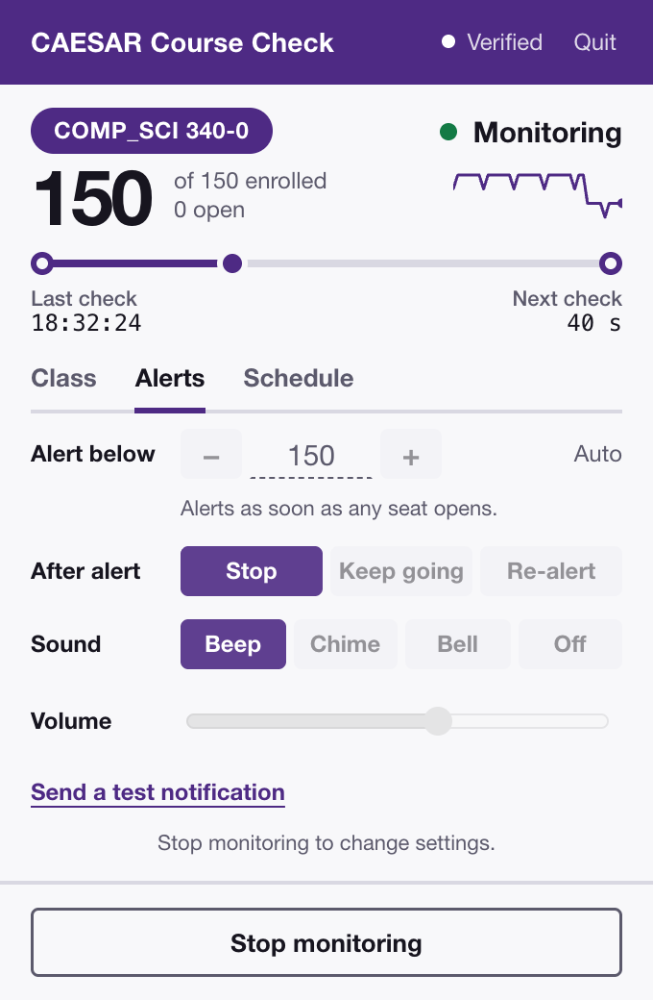

<p align="center"></p>

# CAESAR Course Check

Watches a Northwestern CAESAR class and alerts you when a seat opens. On macOS it lives in the menu bar. On Windows it is a normal window.

**[Download the latest version](https://github.com/VinnyT456/Caesar-Course-Check/releases/latest)**: get the `.dmg` (macOS) or the `.exe` (Windows) from the **Assets** list on that page.

| First run | Monitoring | Alert settings | Seat found (dark) |
|---|---|---|---|
|  |  |  |  |

Screenshots are browser renders with sample data. The menu bar itself isn't pictured.

## Install
Needs Google Chrome, and macOS (Apple Silicon) or Windows 10/11.

1. Open the [latest release](https://github.com/VinnyT456/Caesar-Course-Check/releases/latest) and download the file for your system.
2. macOS: open the `.dmg` and drag the app to **Applications**. Windows: run the `.exe`.
3. The builds are unsigned, so the first launch needs one extra step.
   - macOS: right-click the app, choose **Open**. Or run `xattr -dr com.apple.quarantine "/Applications/CAESAR Course Check.app"`.
   - Windows: SmartScreen, **More info**, **Run anyway**.

Releases are built by GitHub Actions when a version tag is pushed. If the release has no files, build it yourself (see [Build](#build)).

## How to use
1. Open the app. On macOS click its icon in the menu bar (it doesn't open by itself). On Windows the window opens.
2. On the **Class** tab pick the term, subject and course. The Subject and Course lists are searchable: click and type.
3. Press **Verify and start**. The first time, Chrome opens so you can solve CAESAR's captcha by hand. It closes itself and monitoring starts. After that the button reads **Start monitoring**.
4. Leave it running. When a seat opens you get a sound and a notification, and the app comes forward. **Open CAESAR** opens the CAESAR sign-in page and copies the class number.

If the captcha comes back later, you get a notification. Solve it in Chrome and monitoring restarts with your last settings.

There is no CAESAR login, only the captcha. The app never solves it for you.

## Features
- Checks about once a minute (plus or minus 15 s) in a headless Chrome.
- Watch up to five classes at once. More classes means more page loads, so captchas come back sooner.
- Pick a section. **Load discussions & labs** lists every section CAESAR has for the course, with times and instructors, so you can watch a discussion or lab. Loading takes a few seconds, up to a minute for big courses, and needs a verified session with monitoring stopped.
- Subjects are listed under their own school, so a code used by two schools (CHEM in Weinberg and SPS) shows both.
- **Alert below** is set by class: Auto alerts when any seat opens, or enter a number. A number above the class size is lowered to the class size after the first check.
- After an alert: stop, keep watching, or repeat every 5 minutes until you open CAESAR or stop.
- Sound: beep, chime, bell or off, with a volume slider.
- Quiet hours pause checks overnight and resume with a fresh search.
- Enrollment graph, seats open, and the waitlist count when CAESAR shows it.
- Graduate courses (400 and up) switch CAESAR's School to The Graduate School for you.
- macOS: no window or Dock icon. The menu bar icon shows the enrollment number, turns green when a seat is open and red when it needs you. Clicking a notification opens CAESAR.
- Windows: minimise the window to keep monitoring. Closing it quits the app. An alert plays a sound, shows a toast, brings the window forward and flashes the taskbar.
- Light and dark mode.

The Windows build has been tried on one Windows VM. Report anything odd as an issue.

## Develop
```bash
uv sync
(cd frontend && npm install && npm run build)
uv run python run_app.py
```

Stack: Python, FastAPI, async Playwright, Svelte and Vite, pyobjc (macOS menu bar), pywebview (Windows window), PyInstaller.

```
caesar_checker/   backend: checker.py (Playwright), server.py (FastAPI), app.py (entry), tray.py (macOS menu bar)
frontend/         Svelte UI, built into caesar_checker/static
packaging/        PyInstaller build, icon and DMG artwork
scraper/          scrapes class-descriptions.northwestern.edu into data/; build_catalog.py writes caesar_checker/catalog.json
data/             scraped course catalog (JSON per school and subject)
scripts/          course_pw.py, the original terminal checker
assets/ docs/     app icon, DMG art, README screenshots
run_app.py        app entry point
```

## Build
```bash
uv run python packaging/build.py
```
- macOS: `dist/CAESAR-Course-Check.dmg`
- Windows: `dist/CAESAR Course Check.exe` (or `packaging\build_windows.bat`)

PyInstaller can't cross-compile, so build the Windows `.exe` on Windows or with the GitHub Actions workflow (`.github/workflows/build.yml`). On macOS the build signs the app with a local Apple Development or Developer ID certificate if you have one, otherwise ad hoc.

## Course catalog
The dropdowns read `caesar_checker/catalog.json`, built from the scraper output in `data/`. To refresh it for a new term:

```bash
uv run python scraper/main.py            # scrape class-descriptions.northwestern.edu into data/ (slow)
uv run python scraper/build_catalog.py   # rebuild caesar_checker/catalog.json, then rebuild the app
```

The checker depends on PeopleSoft element IDs on the CAESAR page. If CAESAR changes them, the app logs what it couldn't find to `app.log` and falls back: the default School, your Alert below number, no waitlist figure.

## Where data is stored
Session, settings and logs live in a `CaesarCourseCheck` folder: `~/Library/Application Support/` on macOS, `%LOCALAPPDATA%` on Windows. Delete it to forget the saved captcha session.

## License
[MIT](LICENSE)
